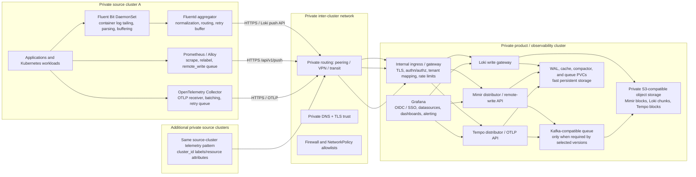

# Multi-cluster Mimir, Tempo, and Loki observability

Reference architecture for collecting telemetry from private Kubernetes source clusters and storing it in a private product cluster. The product cluster runs Grafana Mimir for metrics, Grafana Loki for logs, Grafana Tempo for traces, Grafana for exploration and dashboards, and the supporting storage, queue, and ingress components.

> **Status:** architecture and implementation roadmap. This repository does not contain credentials or assume cluster-specific network, storage, or Kubernetes versions. Chart versions and production values must be locked after the compatibility and capacity decisions in [the roadmap](ROADMAP.md).

> **Portfolio context:** this reference project is based on the public portfolio case study, which describes Mimir and Loki installed with Helm and Tempo deployed with a Kubernetes operator. This repository follows the newer brief for a multi-cluster design using Helm chart families, and does not claim to reproduce the employer's original topology or internal implementation.

## Architecture



### Trust and reachability

Both Kubernetes clusters are private. An ingress controller or internal load balancer inside the product cluster does **not** by itself make a service reachable from the source clusters. The network must route between their private address spaces, and source-cluster DNS must resolve the product cluster's internal ingress names. Use private peering, transit routing, or VPN connectivity; allow only the required source CIDRs and telemetry ports. No telemetry endpoint should be published to the public internet.

Terminate TLS at the internal gateway with certificates trusted by every source cluster. Require workload or client authentication (prefer mTLS or short-lived workload identity), authorize each source cluster to its own tenant, and inject/validate the tenant header at the gateway. Mimir and Tempo do not provide a complete authentication boundary by themselves; Loki also needs an authenticating proxy/gateway. Keep Grafana user access on a separate authenticated route. Do not route cluster-internal Mimir, Loki, Tempo, Kafka, or object-store ports through the cross-cluster ingress.

### Signal paths

| Signal | Source-cluster component | Product-cluster endpoint | Storage / query |
|---|---|---|---|
| Logs | Fluent Bit DaemonSet tails container logs and forwards to Fluentd; Fluentd normalizes metadata, buffers, retries, and ships to Loki | Internal Loki write gateway / push API | Loki object storage; Grafana Loki datasource |
| Metrics | Prometheus or Grafana Alloy scrapes cluster/application targets and remote-writes with a stable `cluster` label | Mimir remote-write API (`/api/v1/push`) | Mimir object storage; Grafana Prometheus-compatible datasource |
| Traces | Application SDKs send OTLP to a local OpenTelemetry Collector; Collector batches and retries | Tempo OTLP gRPC/HTTP receiver via authenticated gateway | Tempo object storage; Grafana Tempo datasource |

Fluent Bit and Fluentd are log pipeline components; they do not replace a metrics scraper or an OTLP trace collector. Fluent Bit can send logs directly to Loki, but the Fluentd hop is retained here because the brief requests both. Keep the Fluentd buffer on persistent storage where possible and size it for the expected outage window. Prometheus/Alloy and OTel Collector queues also need explicit retry and disk-buffer decisions.

### Product-cluster infrastructure

- **Kubernetes:** dedicated namespaces and resource quotas for `observability`, plus node pools with predictable CPU, memory, and local/attached disk. Use topology spread, pod disruption budgets, anti-affinity, readiness probes, and autoscaling where supported.
- **Storage:** production object storage should be a private, durable S3-compatible service with encryption, versioning or lifecycle policies, and backups. Use persistent volumes for WALs, caches, compaction scratch space, and Kafka data. Define retention and deletion policies per signal before enabling ingestion.
- **Kafka-compatible queue:** recent Mimir ingest-storage and Tempo 3 architectures may require a Kafka-compatible queue. Choose exact chart/app versions first, then provide isolated topics, quotas, replication, and a supported queue deployment or managed private service. Do not assume one queue or chart default is production-ready.
- **Ingress and network:** internal-only load balancer and ingress class, private DNS, TLS, authentication, tenant enforcement, request-size/rate limits, and source CIDR allowlists. Expose only the three write APIs to source clusters.
- **Access:** Grafana behind SSO/OIDC; read-only roles by default; separate operator and tenant administration. Provision datasources and dashboards as code. Store secrets in the platform secret manager or an external-secrets integration.
- **Operations:** alert on ingestion errors, queue/buffer saturation, rejected samples, object-store failures, compaction backlog, Kafka health, PVC pressure, and cross-cluster network failures. Monitor the observability stack through an independent path so a central outage does not hide itself.

## Helm repositories and chart families

```bash
helm repo add grafana https://grafana.github.io/helm-charts
helm repo add grafana-community https://grafana-community.github.io/helm-charts
helm repo add fluent https://fluent.github.io/helm-charts
helm repo add open-telemetry https://open-telemetry.github.io/opentelemetry-helm-charts
helm repo update
```

| Cluster | Chart family | Placement |
|---|---|---|
| Product | `grafana/mimir-distributed` | Mimir backend and write/query API |
| Product | `grafana-community/loki` | Loki backend and internal write/query gateway |
| Product | `grafana/tempo-distributed` (or `grafana/tempo` for a deliberately small installation) | Tempo backend and OTLP endpoint |
| Product | `grafana-community/grafana` | Grafana UI, datasources, dashboards |
| Product | Kafka-compatible queue chart/service, if required for the selected Mimir/Tempo versions | Internal only; never exposed through telemetry ingress |
| Each source | `fluent/fluent-bit` and `fluent/fluentd` | Node log collector and cluster log aggregator |
| Each source | `open-telemetry/opentelemetry-collector` | OTLP collection and export to Tempo |
| Each source | Prometheus Operator/Prometheus or Grafana Alloy chart | Scrape and remote-write metrics to Mimir |

Use explicit, compatible chart and image versions in the deployment values and lock files. These charts evolve independently. Review upstream migration notes before upgrades; the Loki chart is currently maintained in the Grafana Community chart repository.

## Repository map

- [`docs/architecture.md`](docs/architecture.md): full topology, network contract, storage, security, sizing decisions, and failure behavior.
- [`ROADMAP.md`](ROADMAP.md): phased implementation and acceptance criteria.
- [`deploy/product-cluster/README.md`](deploy/product-cluster/README.md): product-cluster release plan and Helm commands.
- [`deploy/source-cluster/README.md`](deploy/source-cluster/README.md): per-source-cluster agent plan and configuration contract.
- [`docs/helm-sources.md`](docs/helm-sources.md): upstream chart/documentation references.

## References

- [Mimir distributed Helm installation](https://grafana.com/docs/helm-charts/mimir-distributed/latest/get-started-helm-charts/)
- [Loki Helm installation](https://grafana.com/docs/loki/latest/setup/install/helm/install-scalable/)
- [Tempo Helm deployment](https://grafana.com/docs/tempo/latest/set-up-for-tracing/setup-tempo/deploy/kubernetes/helm-chart/)
- [Fluent Helm charts](https://github.com/fluent/helm-charts)
- [OpenTelemetry Collector Helm chart](https://opentelemetry.io/docs/platforms/kubernetes/helm/collector/)
