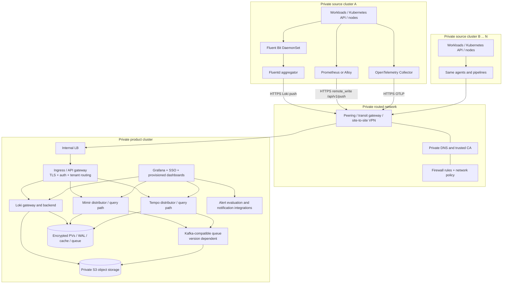

# Full infrastructure architecture

This is a proposed reference design derived from the public portfolio summary and the current multi-cluster brief. The public case study says Tempo was deployed with an operator; this design documents Helm chart alternatives as requested and does not assert that its multi-cluster routing or internal component layout matches the employer's implementation.

## Deployment boundary

Use one **product cluster** as the central telemetry and dashboard platform and one or more **source clusters** as private producers. All clusters remain private. The product cluster accepts authenticated ingestion over internal endpoints; source clusters never need direct access to backend pods or databases. The Grafana UI is for operator and engineering users and has a distinct identity-aware route.

## Network contract

Private ingress describes where a load balancer is reachable; it does not create a route between isolated cluster networks. Before deploying agents, establish and test all of the following:

1. Non-overlapping CIDRs and bidirectional private routes between each source cluster network and the product cluster's internal ingress address.
2. Private DNS names resolvable from every source cluster and from Grafana/operator networks.
3. Firewall rules allowing only source-cluster egress to the product cluster's HTTPS telemetry ingress. Keep Kafka, object storage, backend gRPC, and Kubernetes API traffic inside their intended trust zones.
4. TLS certificates and trust bundles distributed to sources; certificate rotation procedure and expiry alerts.
5. Authentication on every ingest route. Prefer mTLS/workload identity. Map each authenticated cluster identity to a Mimir/Loki/Tempo tenant; never trust arbitrary client-supplied tenant headers.
6. A separate user route for Grafana using SSO/OIDC, plus admin access restricted to an operator network or bastion.

The ingress routes should map stable names to version-specific backends. A typical contract is `logs.obs.private` to Loki push, `metrics.obs.private` to Mimir remote write, and `traces.obs.private` to Tempo OTLP. Check each backend's API path and protocol support against the chosen gateway/controller. OTLP gRPC may require HTTP/2 and gRPC pass-through; OTLP/HTTP can be simpler through generic ingress but must be confirmed for the selected collector and Tempo configuration.

## Product-cluster runtime and data

### Mimir

Accept Prometheus remote-write requests at the distributor API. Put `cluster`, `environment`, and `region` labels on series at the source; configure a tenant identity per source cluster or per agreed isolation boundary. Use object storage for long-lived blocks and persistent volumes for WAL/cache/scratch state. Current Mimir chart architecture defaults may require Kafka-compatible ingest storage; resolve this against the exact chart/app versions in phase 0.

### Loki

Use the current community-maintained Loki Helm chart. Put the authenticated gateway in front of write and query paths. Logs should carry bounded-cardinality labels such as `cluster`, `namespace`, `app`, and `environment`; avoid pod UID, request ID, or user ID as Loki index labels. Use object storage and explicit retention/compactor settings. Configure Fluentd output plugins and label mapping to match Loki's current push API.

### Tempo

Receive OTLP from source-cluster Collectors. Tempo has no built-in authentication layer, so the gateway must authenticate and authorize requests. Persist trace blocks in private object storage. Tempo 3 documentation requires a Kafka-compatible queue; validate the selected Tempo major version, chart defaults, and queue topology before rollout.

### Grafana and alerting

Provision Mimir, Loki, and Tempo data sources with server-side credentials. Configure trace-to-logs and trace-to-metrics links using common resource attributes and labels. Provision dashboards by cluster and service, then create alerts for both application symptoms and telemetry-pipeline health. Keep notification credentials in a secret manager, not in Helm values committed to this repository.

### Storage and recovery

Use a private S3-compatible object store with encryption at rest, TLS, bucket policy isolation, lifecycle rules, and tested restore procedures. Define separate buckets or prefixes and credentials for Mimir, Loki, and Tempo. Set PV storage classes and capacity for WALs, compaction scratch, caches, and queue data. Define retention, backup, RPO, and RTO explicitly. Size storage from measured daily ingestion, retention days, replication/compaction overhead, and growth headroom; do not treat example chart defaults as production sizing.

## Source-cluster components

| Component | Workload | Collection / export responsibilities |
|---|---|---|
| Fluent Bit | DaemonSet, one per node | Tail container logs, enrich Kubernetes metadata, persist tail offsets, forward over Fluent Forward to Fluentd with retry/buffering |
| Fluentd | Deployment/StatefulSet aggregator | Normalize, filter/redact, buffer to disk, route to Loki; HA replicas need a deliberate buffer and ordering design |
| Prometheus or Alloy | Prometheus HA pair or Alloy agents | Scrape kubelet, kube-state-metrics, node/application exporters; apply relabeling and remote-write queue to Mimir |
| OpenTelemetry Collector | DaemonSet plus optional gateway Deployment | Receive OTLP from instrumented applications, enrich with cluster/resource attributes, batch, retry, and export to Tempo |

Deploy source releases with cluster-specific values and labels. Agents must continue to buffer locally during temporary inter-cluster outages, with explicit disk quotas and backpressure behavior so telemetry does not consume all node or PVC storage.

## Security and operational controls

- Use least-privilege Kubernetes RBAC and namespace isolation; log-agent host mounts should be read-only where supported.
- Keep credentials out of Git. Use external secrets, workload identity, or a secret manager and rotate credentials and certificates.
- Configure tenant isolation at the gateway, TLS on all network hops, source allowlists, ingress request limits, and ingress audit logs.
- Apply Kubernetes resource requests/limits, quotas, PDBs, topology spread, anti-affinity, and autoscaling based on measured load.
- Monitor collector queues, Fluentd buffer utilization, dropped/failed exports, Mimir rejected samples, Loki ingestion errors, Tempo distributor errors, Kafka lag, object-store latency/errors, PV headroom, and compaction backlogs.
- Keep an independent monitoring path for the product cluster and an operational runbook for loss of central observability.

## Failure behavior

| Failure | Expected behavior | Recovery control |
|---|---|---|
| Source-to-product network outage | Source agents queue data locally until limits are reached; application traffic remains independent | Disk buffers, bounded retry/backoff, queue saturation alerts, and a tested outage-window target |
| Internal DNS/TLS error | Export fails closed; no plaintext fallback | DNS/TLS synthetic probes from each source cluster; certificate rotation and trust bundle checks |
| Product ingress unavailable | All sources retry and buffer; product alerting should notify through independent monitoring | Ingress replicas, internal LB health checks, rollout rollback, spare capacity |
| Object storage or Kafka unavailable | Ingestion may degrade or queue; PVCs can fill | Durable queue/PV sizing, object-store health alerts, per-service runbooks and recovery tests |
| One tenant or source misbehaves | Gateway quotas/rate limits isolate its impact | Per-tenant limits, cardinality controls, log rate limits, and source attribution |

## Decisions to lock before production

- Kubernetes distributions/versions, regions, CNI, ingress controller, internal LB, and exact routing method.
- Helm chart and application version matrix, particularly Loki chart migration state and Mimir/Tempo Kafka requirements.
- Tenant model, identity provider, TLS/mTLS issuer, and gateway implementation.
- Object-storage provider, bucket layout, encryption, retention, and recovery objectives.
- Expected logs/metrics/traces volume, retention, SLOs, and resulting compute/storage capacity.
- Whether Fluentd is required for transformations/routing, or whether source Fluent Bit can send directly to Loki.
